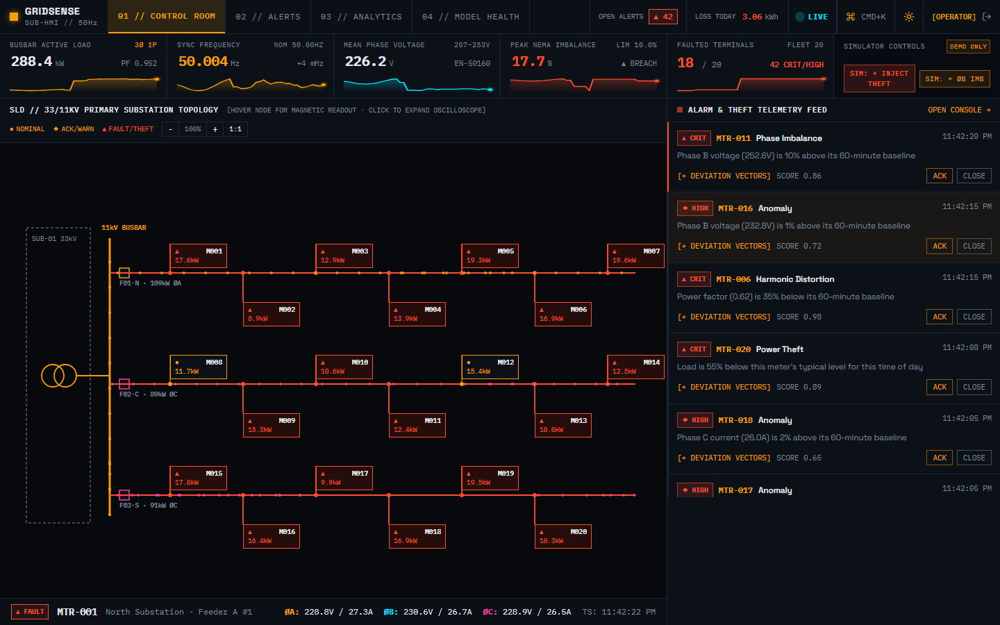
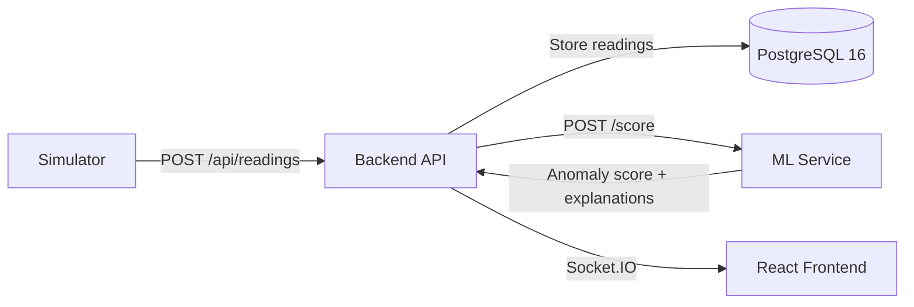

# GridSense

GridSense is a real-time electrical fault and power-theft monitoring platform built for distribution utility operators and grid engineers. It ingests three-phase smart-meter telemetry, scores readings with an anomaly detection ensemble, and streams alerts with plain-language explanations to a web control room. All telemetry and fault events in this repository are synthetically simulated.


*Control Room showing the 3-feeder single-line schematic, live alert feed, and header status counters.*

## Quick start

Prerequisites: Docker and Docker Compose.

```bash
cp .env.example .env
docker compose up -d --build
```

Open `http://localhost:5173` in your browser. On `/login`, sign in with the seeded **demo-only credential**:

- Email: `operator@gridsense.local`
- Password: `ChangeMe123!` (demo-only; override `ADMIN_PASSWORD` and rotate all seeded passwords before any non-local deployment)

The backend API is at `http://localhost:4000` and the ML service docs are at `http://localhost:8000/docs`.

## How it works



The Python simulator sends three-phase voltage, current, power factor, and frequency readings to the backend over `POST /api/readings` using an `X-API-Key` header. The backend stores each reading idempotently in PostgreSQL and forwards the batch to the FastAPI ML service, which runs an Isolation Forest, a 60-step PyTorch LSTM Autoencoder, and deterministic electrical rules. Flagged readings are deduplicated over a 5-minute sliding window per meter and fault type, written to `alerts` and `alert_events`, and pushed to authenticated clients over Socket.IO.

## Results

Measured on simulated held-out data (`11,500` readings, final 20% chronological split of a 30-day simulation) on `2026-11-14T14:35:01.465153Z` (see [docs/model-evaluation.md](docs/model-evaluation.md)):

| Metric | Value |
| --- | ---: |
| Precision | 0.7624 |
| Recall | 0.9963 |
| F1 Score | 0.8638 |
| False Positive Rate (FPR) | 0.0728 |
| Confusion Matrix (TP / FP / FN / TN) | 2175 / 678 / 8 / 8639 |

Per-fault breakdown on the same split:

| Fault Type | Support | Precision | Recall | F1 Score | FPR |
| --- | ---: | ---: | ---: | ---: | ---: |
| `phase_imbalance` | 359 | 1.0000 | 0.9916 | 0.9958 | 0.0000 |
| `overcurrent_spike` | 182 | 1.0000 | 1.0000 | 1.0000 | 0.0000 |
| `harmonic_distortion` | 252 | 1.0000 | 1.0000 | 1.0000 | 0.0000 |
| `power_theft` | 687 | 0.9927 | 0.9927 | 0.9927 | 0.0005 |
| `voltage_sag` | 335 | 0.9384 | 1.0000 | 0.9682 | 0.0020 |
| `voltage_swell` | 368 | 0.9634 | 1.0000 | 0.9814 | 0.0013 |

## Energy loss estimate

Energy loss is computed only for `power_theft` alerts using the shared helper in `backend/src/energyLoss.ts` and `frontend/src/analytics/aggregate.ts`:

- Primary (interval metering delta): `max(0, expected_kwh - measured_kwh)`
- Fallback A (baseline power delta): `max(0, baseline_kw - measured_kw) * max(0, duration_hours)`
- Fallback B (streaming integration): stored `energy_loss_kwh` if positive, otherwise `max(0, loss_kw * max(0.25, (last_detected_at - detected_at) / 3600000))`

This figure is an operational estimate for triage, not billing data.

## Demo

See [docs/demo-script.md](docs/demo-script.md) for the full walkthrough. Summary:

1. Sign in at `http://localhost:5173` with `operator@gridsense.local` / `ChangeMe123!` and confirm the `LIVE` badge in the top bar.
2. Inject a live power-theft event on `MTR-001` via `docker compose exec simulator python -m simulator.cli --mode inject-theft --target-meter MTR-001 --endpoint http://backend:4000/api/readings`.
3. Confirm the new alert arrives in `/alerts` within 5 seconds, acknowledge it, and verify the open-alert count and audit log update.

## Limitations

- Simulated data only: readings and fault signatures are synthetic and have not been validated on physical smart-meter hardware.
- Mock fallback behavior: when the backend or Socket.IO is unreachable (or when entering Offline Mock mode on `/login`), the header displays a `MOCK` badge and runs a 1 Hz synthetic stream in the browser.
- Vite dev proxy path (`/model/` vs `/model`): `frontend/vite.config.ts` proxies `/model/` with a trailing slash to the ML service so client-side navigation to `/model-health` is not intercepted.
- Meter ID convention: live seeded database and simulator records use `MTR-001` through `MTR-020`, whereas offline mock data uses `MTR-0101` through `MTR-0120` (resolved via `findMeterById`).

## Project layout

```text
.
├── backend/      Express API, PostgreSQL schema/seed, JWT RBAC, Socket.IO
├── docs/         Architecture, model evaluation, demo script, screenshots
├── frontend/     React, TypeScript, Tailwind CSS, and Recharts UI
├── infra/        CI and compose configuration files
├── ml-service/   FastAPI scoring service, feature engineering, model artifacts
└── simulator/    Python 3-phase smart-meter telemetry and fault CLI
```

## Decisions

- UTC storage, IST display: timestamps are stored as UTC ISO-8601 strings in PostgreSQL and grouped by `Asia/Kolkata` (IST) calendar days for daily loss and analytics charts.
- Explicit `MOCK` fallback: kept a browser-side fallback stream so the UI remains inspectable without Docker, gated behind a visible `MOCK` badge so simulated data is never mistaken for live telemetry.
- No hardcoded model metrics: `/model-health` reads exclusively from `GET /model/info` and renders `NOT EVALUATED` with dashes when the ML service is down rather than showing placeholder numbers.

## License

Coursework and demonstration project; see [LICENSE](LICENSE).
