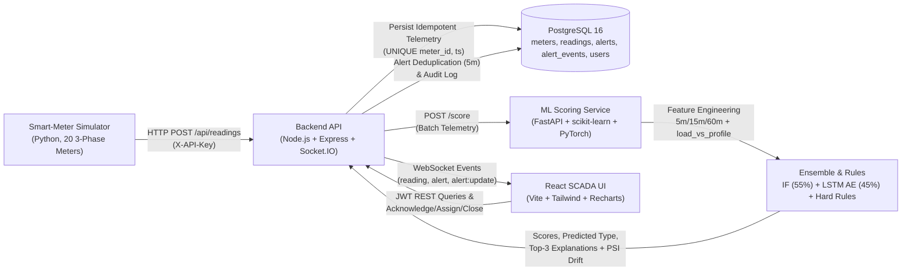
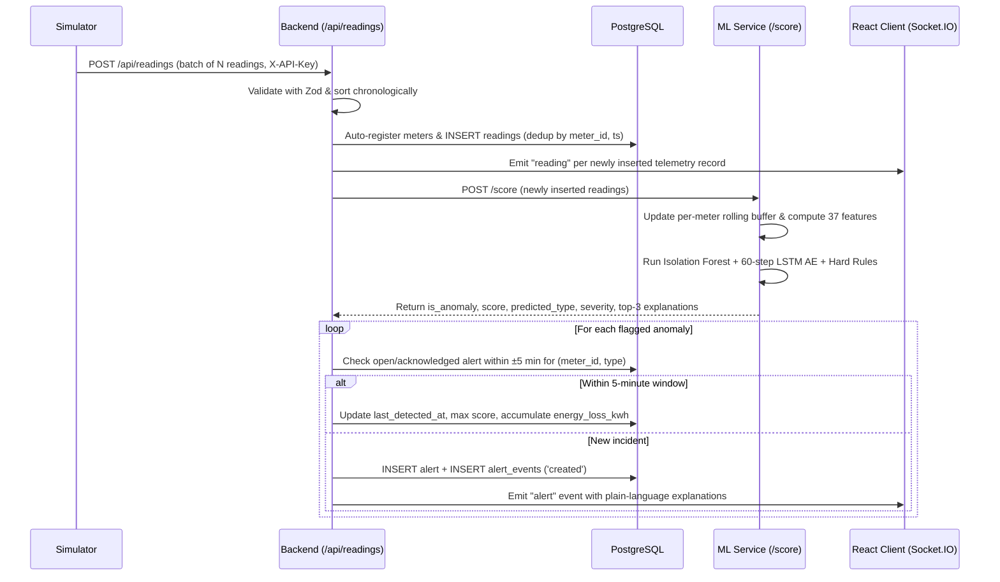

# GridSense Architecture

## System Overview

GridSense is a real-time three-phase electrical fault and power-theft detection platform organized as a modular monorepo:

- **`/simulator` (Python)**: Emits 3-phase smart-meter readings (voltage A/B/C, current A/B/C, power factor, frequency, cumulative kWh) with daily load curves and fault/theft injection over a pluggable `Transport` interface.
- **`/ml-service` (Python + FastAPI + scikit-learn + PyTorch)**: Engineers rolling temporal features and time-of-day load profiles, runs an Isolation Forest + 60-step LSTM Autoencoder + Deterministic Hard Rule Layer ensemble, generates top-3 plain-language explanations, and tracks feature distribution drift via Population Stability Index (PSI).
- **`/backend` (Node.js + TypeScript + Express + Socket.IO + PostgreSQL)**: Validates and ingests telemetry batches idempotently, calls `/score`, deduplicates alerts over a 5-minute sliding window, estimates stolen energy (`kWh`), records an immutable `alert_events` audit trail, enforces JWT RBAC, and streams live updates via Socket.IO.
- **`/frontend` (React + Vite + TypeScript + Tailwind CSS + Recharts)**: SCADA-style control center providing Live Fleet Overview, 15-minute rolling Meter Detail charts, filterable Alerts with expandable explanations, Analytics & CSV exports, and Model Health / Drift visibility.

---

## High-Level Architecture

---

## Real-Time Ingestion & Alert Data Flow

---

## ML Feature Engineering & Ensemble Design

1. **Feature Engineering (`/ml-service/features.py`)**:
   - **Rolling Windows**: Mean and standard deviation of 3-phase voltage and current over `5m`, `15m`, and `60m` per meter.
   - **Per-Phase Ratios & NEMA Imbalance**: `voltage_ratio_*`, `current_ratio_*`, and NEMA-style imbalance index $\max(|X_{\text{phase}} - \bar{X}|) / \bar{X}$.
   - **Time-of-Day Load Profile (`load_vs_profile`)**: Median normal current per meter across 96 daily 15-minute slots (`0..95`) learned exclusively on normal training rows. Compares current load against expected load for that exact time slot so sustained power theft does not mask itself inside a moving 60-minute average, and normal evening load ramps do not cause false alarms.
   - **Rate of Change & PF Deviation**: Step-over-step deltas (`current_mean_roc`, `voltage_mean_roc`, `pf_roc`) and deviation from nominal power factor (`0.95`).
2. **Scoring Ensemble (`/ml-service/models.py`, `/ml-service/inference.py`)**:
   - **Model 1 — Isolation Forest**: Trained on normal training samples (`contamination=0.03`).
   - **Model 2 — PyTorch LSTM Autoencoder**: Trained on 60-step sliding windows (`seq_len=60`) that are at least 80% normal with normal tail steps; reconstruction MSE is evaluated over the final 5 steps (`tail=5`) and calibrated against the 98th validation percentile.
   - **Hard Rule Layer**: Deterministic guardrails for EN 50160 voltage limits (`< 207V` sag / `> 253V` swell), NEMA current imbalance (`>= 10%`), harmonic power-factor drop (`< 0.78`), overcurrent surge (`>= 1.75x`), and power-theft signature (`>= 28%` load drop vs. time-of-day profile while voltage remains `215V–245V`).
3. **Explainability (`/ml-service/explainability.py`)**:
   - Ranks candidate deviations by standardized contribution (`z_score`) and emits the top 3 plain-language descriptions (e.g., `"Load is 48% below this meter's typical level for this time of day"`).
4. **Drift Monitoring**:
   - Tracks a rolling window (`500` readings) across 6 key telemetry features and calculates Population Stability Index (PSI) against training quantile bins, surfacing `drift_warning: true` when `max_psi > 0.20`.

---

## Database Schema & Security Model

- **`users`**: Stores salted `bcrypt` password hashes and RBAC roles (`admin`, `operator`, `viewer`).
- **`meters`**: Smart-meter registry with `last_seen` monotonic watermark.
- **`readings`**: Time-series table indexed on `UNIQUE (meter_id, ts)` for idempotent duplicate handling and fast range queries.
- **`alerts` & `alert_events`**: Incident lifecycle (`open` → `acknowledged` → `closed`), assignee tracking, estimated `loss_kw` / `energy_loss_kwh`, and append-only audit log.
- **Access Control**:
  - `POST /api/readings` requires `X-API-Key`.
  - All user API routes and Socket.IO handshakes require a signed JWT (`Authorization: Bearer <token>`).
  - `viewer`: read-only telemetry, alerts, analytics, and model health.
  - `operator`: acknowledges, assigns, and closes alerts; exports incident CSVs.
  - `admin`: full operator permissions plus `POST /api/auth/register`.
